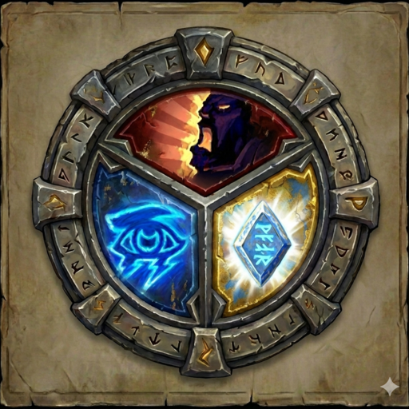
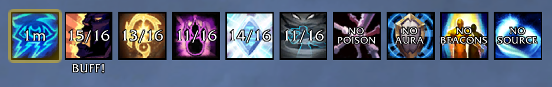
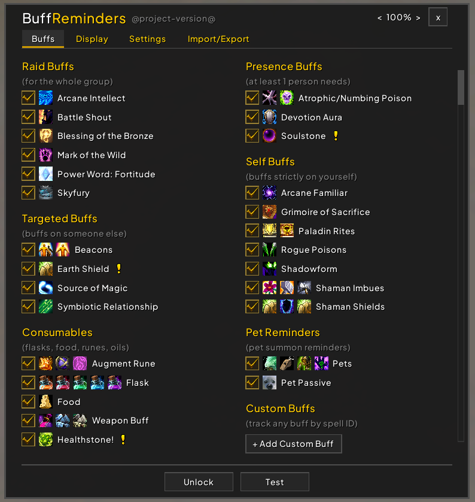
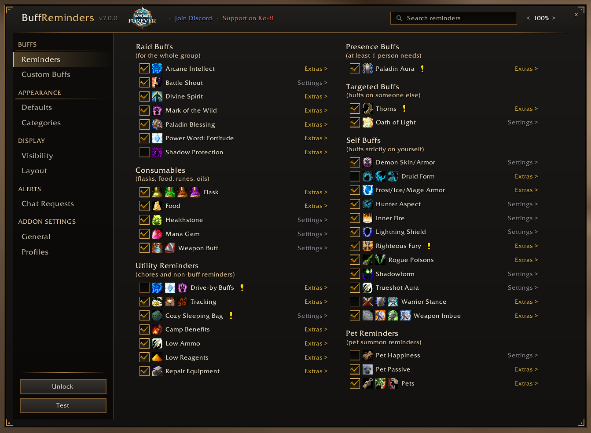

<h1 align="center">BuffReminders</h1>

  

  
  
  

<h3 align="center">Track missing buffs at a glance</h3>

Works on Retail and WoW Forever.

From the author of <a href="https://wago.io/iWkZ4Eq-i">Raid Buffs Tracker</a>, one of the most popular raid buffs tracking WeakAuras.

  

Check what buffs you or your party are missing, and easily click to cast them!
Supports consumables, pets, and more. Add custom buffs to track whatever you want.

  

## Configuration

Type `/br` to open the options panel.
Choose which buffs you want to track and how you want them to look. The panel matches the look of each client.

<table>
  <tr>
    <th>Retail</th>
    <th>WoW Forever</th>
  </tr>
  <tr>
    <td></td>
    <td></td>
  </tr>
</table>

## Highlights

- **External buffs (Retail)** - see the Power Infusion, Innervate, Bloodlust, and defensives you receive, even in combat and Mythic+.
- **Custom buffs** - track any spell or item you like.
- **Smart counts** - only alive, connected group members who benefit from a buff are counted, filtered by spec where possible.

## Playing WoW Forever?

BuffReminders comes with extra reminders made just for it:

- **Paladin blessings, sorted out** - pick a main and backup blessing per class, use Greater Blessings, and get warned when another paladin already covers your blessing or aura.
- **Never run out** - low warnings for ammo matched to your bow or gun, and for reagents like Ankhs, Symbol of Kings, and Arcane Powder.
- **Made for leveling** - tracks your buffs on group mates out in the world, reminds you to set up camp and use the Well-Rested sleeping bag, and turns tracking back on after you die.

...and much more.

## Support

Got a bug to report, a feature idea, or just want to see what's coming next? Join the [Discord](https://discord.gg/qezQ2hXJJ7)!

If BuffReminders makes your raids a little smoother, consider [supporting development on Ko-fi](https://ko-fi.com/zerbyy) ❤️
